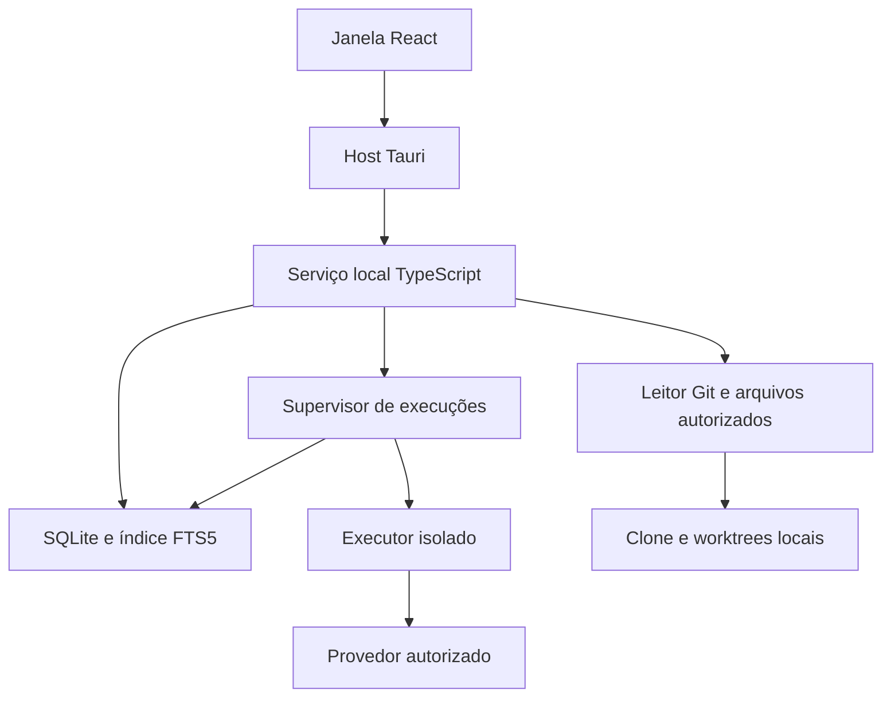

# Arquitetura da plataforma desktop

**Decisão de implementação.** Monólito modular local com janela Tauri 2, React, Vite e TypeScript. O host Rust abre o seletor nativo, controla o processo auxiliar e expõe comandos tipados. Um sidecar Node/TypeScript contém os serviços de projeto, operações Git, persistência SQLite e adaptadores. O mesmo núcleo poderá atender a uma CLI de diagnóstico. O caminho principal de uso e de teste de aceitação começa no desktop.

## Fronteiras físicas



A UI envia IDs de projeto e tarefa ao host. Somente o serviço resolve caminhos cadastrados. Comunicação host–sidecar por stdio com envelopes limitados, IDs de requisição, resposta tipada e canal de eventos. Sem porta HTTP na rede local. O host expõe uma lista fechada de operações. Escopos de IPC do Tauri restringem comandos do renderer; o confinamento do processo externo depende do sistema operacional e requer teste próprio. [Capabilities do Tauri](https://v2.tauri.app/security/capabilities/) · [Sidecars](https://v2.tauri.app/develop/sidecar/)

### Organização inicial do monorepo

```text
apps/desktop/             React, composição de telas e src-tauri
packages/core/            workspace, projetos, tarefas, Git, contexto e persistência
packages/contracts/       DTOs, validação de entrada e compatibilidade
packages/agents/          adaptador Codex e normalização de eventos
apps/local-service/       ponto de entrada do sidecar, injeção de dependências e supervisor
tests/fixtures/           repositórios mínimos gerados em teste e eventos sanitizados
```

O serviço é um único processo por instância do app, dono das conexões de escrita. O host resolve um binário empacotado por SO/arquitetura. Em desenvolvimento pode iniciar a versão de Node declarada pelo projeto, com as dependências fixadas pelo lockfile. Desde S1, testar empacotamento do runtime e do binding SQLite na máquina alvo; usuário final não deve precisar instalar Node ou Rust. Exigir Git disponível e orientar sua instalação. Codex é dependência opcional para ações de agente. Componentes compartilhados começam em apps/desktop. Extrair pacote de UI ou apps/cli quando surgir um segundo consumidor.

| Responsabilidade lógica | Local inicial | Fronteira que protege |
|---|---|---|
| Workspace, projetos e tarefas | core/workspace e core/tasks | Resolve IDs e impede associação entre objetos de clientes diferentes |
| Integração Git | core/git | Executa Git por argv, sem interpolação de shell; normaliza caminhos e limita raiz |
| Inteligência de projeto e busca | core/intelligence | Extrai fatos de manifestos conhecidos, agrega atividade e FTS5; identifica origem e instante |
| Contexto e evidências | core/context e core/evidence | Materializa bytes e motivos de seleção; mantém separado o que foi observado e o que foi aceito |
| Supervisor e adaptadores | local-service e agents | Negocia capacidades, aplica autorizações e persiste tentativas antes de iniciar o processo |
| Eventos e plugins | core/storage e contracts | Log transacional resumido; plugins externos só em etapa posterior com permissões declaradas |

## Quatro estados que não podem se confundir

| Objeto | Identidade / conteúdo | Como é obtido e usado |
|---|---|---|
| **Committed Snapshot** | Formato de objeto Git e OID completo do commit e da árvore, ou ausência de HEAD | Ler objetos locais pelo SHA resolvido uma vez. Branch é apenas rótulo de navegação. |
| **Working Tree State** | ID de captura, worktree, HEAD opcional, índice e arquivos modificados selecionados com origem staged/unstaged/untracked, caminho, tamanho e digest | S1 observa status sem guardar os bytes de tudo. S2 captura somente fontes selecionadas para leitura. S4 materializa a captura tipada para comparação. Arquivo excluído é entrada de remoção; renome ambíguo é indeterminado. |
| **Agent Execution Context** | Manifesto com versão, base, seleção ordenada, digests, trechos/bytes autorizados, omissões, instruções, ferramentas, destino e perfil | O supervisor fixa o manifesto antes de disparar a tentativa. A aba permite inspecionar exatamente o material enviado e o material adicional que o executor pode acessar. |
| **Evidence Snapshot** | Referência a commit/blob ou digest de bytes locais, linhas e origem, artefato, comando/ambiente quando aplicável, instante e execução | Um teste de A permanece um fato de A. Igualdade de bytes prova igualdade de conteúdo; cobertura de requisito depende de evidência e revisão apropriadas. |

**Exemplo.** Em main, o índice tem a versão B do exportador e a cópia de trabalho tem a versão C. O teste passa sobre B em área materializada. A tela mostra “teste observado sobre o índice B” e o diff B→C. Para revisar C, o usuário seleciona C e inicia outra execução. Um arquivo novo só aparece na lista de nomes até ser escolhido. No caso de um arquivo alterado durante a captura, reler e comparar metadados e digest; em conflito, descartar a geração e pedir nova seleção. Mudanças entre arquivos não constituem uma transação do sistema de arquivos. Para resultados reproduzíveis usar os bytes efetivamente materializados e declarar essa fronteira.

Git fornece status parseável com porcelain v2 e separadores NUL. Distinguir índice e cópia de trabalho, considerar remoções, conflitos de merge e HEAD destacado. Normalizar diretório real e identidade de worktree. Não seguir symlink/reparse point para fora da raiz. Submódulos e binários começam como metadados. Para Windows, testar Unicode, caixa, CRLF e caminhos longos. Para WSL, tratar execução no Windows e distribuição Linux como ambientes distintos, com credenciais e permissões próprias. [Git status](https://git-scm.com/docs/git-status) · [Git worktree](https://git-scm.com/docs/git-worktree)

## Contratos mínimos, evolutivos

| Operação | Pedido → resposta | Invariante |
|---|---|---|
| workspace.addLocal | seleção via diálogo nativo → projectId, repoId, worktreeId, summary | Recadastrar a mesma raiz seleciona o registro existente. Não cria nem altera o repo. |
| project.inspect | projectId, worktreeId → summary, observedAt, status[], stale | Um resultado atrasado atualiza somente a captura correspondente. |
| context.prepare | projectId, sessionId, selectedSources, intent, mode → contextId, digest, exposurePreview | Mudar destino, seleção ou capacidade invalida grant incompatível. |
| session.ask / task.start | sessionId, contextId, mode, grantId, requestId → executionId | Uma chave repetida devolve a mesma tentativa. UI pode reconectar sem duplicar custo. |
| execution.events / cancel | executionId, afterSeq / requestId → eventos ou estado observado | Sequência crescente por tentativa; consumidor pula duplicatas. Cancelar solicita parada e espera confirmação. |
| result.review | executionId, expectedBase, choice, revision → decisão ou conflito | Resultado, decisão e aplicação são fatos distintos. Um diff humano aprovado pode ainda não ter sido aplicado. |

DTO proposto para um evento: `{schemaVersion: 1, id, projectId, sessionId, executionId, seq, type, observedAt, payload}`. Tipos iniciais: queued, started, message.delta, usage.reported, change.available, cancel.requested, completed, failed, interrupted. Apenas eventos verificados do supervisor causam transições. Texto produzido pelo modelo é dado. Campos opcionais podem evoluir; mudança incompatível recebe nova versão e migrador. Manter fixture de ao menos uma versão anterior quando surgir a segunda. Nenhum formato precisa ser congelado antes da primeira janela.

## Persistência e recuperação

| Tabelas iniciais | Chaves, índices e regra |
|---|---|
| projects, repositories, worktrees | IDs locais opacos, raiz canônica única por identidade de checkout, lastActive, último resumo. Workspace pessoal pode ser o próprio catálogo. Branch vem do Git. |
| tasks, sessions, messages | Cada entidade aponta para seu projeto. Session tem taskId opcional. Vincular tarefa existente verifica projeto. Conteúdo de mensagens separado do log técnico. |
| executions, execution_events | requestId único, sessão, adapter/version, contextId, modo, tentativa, estado, último seq, início/fim. Chave única (executionId, seq). Transição e evento terminal na mesma transação. |
| contexts, context_entries, artifacts | Hash e origem da fonte, estado observado e escopo. Artefatos grandes fora do banco por digest, com arquivo temporário, rename e coleta de órfãos. |
| decisions, evidences, links | Inclui razão, autor local, escopo, sourceId, reviewedState, validade e relação com versão anterior. Adicionar na S4; o primeiro chat só precisa do vínculo mensagem→fonte. |

Usar transações SQLite, foreign keys habilitadas por conexão, escritor serial e WAL em disco local. Migrações numeradas testadas em uma cópia consistente com o mecanismo de backup do SQLite, incluindo estado em WAL; rollback de binário somente para esquema suportado. Interromper migração nunca autoriza apagar o banco. Índices são reconstruíveis; mensagens, decisões e manifestos requerem preservação. Expurgo por projeto limpa blobs não referenciados e deixa explícito que exportações externas precisam ser removidas no destino. [SQLite WAL](https://sqlite.org/wal.html) · [FTS5](https://www.sqlite.org/fts5.html)

### Ciclo da execução

Criar intenção idempotente em transação → verificar contexto e autorização → criar área isolada → iniciar processo com handle sob supervisão → gravar eventos ordenados → emitir deltas coalescidos ao renderer → persistir saída/diff e estado terminal → liberar recursos. O executor recebe apenas o material autorizado; o app mantém o clone e o banco fora da área gravável.

Fila local com uma tentativa ativa inicialmente. Um timeout solicita cancelamento e pode exigir terminar a árvore de subprocessos por mecanismo do SO. Estados finais distintos: concluída, falhou, cancelada confirmada e interrompida/resultado desconhecido. Ao reabrir, reconciliar tentativas sem terminal via identidade verificável do processo e token da instância. Nunca confiar apenas no PID reutilizável. Sem prova de reconexão, marcar interrompida e oferecer nova tentativa com ligação à anterior. Retomar histórico do aplicativo funciona sempre; continuar o mesmo processo ou a mesma conversa do provedor depende do adaptador.

## Primeiro adaptador e permissões

**Codex nas S2 e S3.** Detectar executável e versão, métodos de autenticação oficialmente suportados e capacidades. Usar execução não interativa, prompt por stdin, eventos JSONL e saída validada para as operações que exigem estrutura. A S2 faz uma consulta real sobre fontes aprovadas. A S3 reaproveita o adaptador e acrescenta tentativa supervisionada com tarefa, cancelamento e resultado de alteração em ambiente controlado. Guardar thread ID se aparecer. Uma nova consulta pode ser reconstruída com histórico escolhido e novo manifesto em uma sessão nova. Um segundo provedor implementará describe, start, events, cancel e opcionalmente resume. [Codex não interativo](https://developers.openai.com/codex/noninteractive/) · [Referência CLI](https://developers.openai.com/codex/cli/reference/)

| Ação | Autoridade e comportamento visível |
|---|---|
| Navegar, abrir uma fonte local | Raiz escolhida e persistida; sem prompt repetido. App evita executar hooks, filtros externos, diffs personalizados e scripts do repositório durante inspeção. |
| Enviar contexto remoto | Exibir destino, arquivos e limites de leitura. Um grant pode valer para escopo/projeto/sessão com opção de revogar. Ampliação de escopo ou troca de destino exige nova aprovação. |
| Executar comandos ou escrever | Runner confinado ao espaço autorizado, sem acesso ao clone original, cofre, perfis herdados ou diretórios de outros projetos. Perfil de escrita e execução de comandos aparecem em linguagem explícita. Só liberar em combinação SO/adaptador que passar testes com sentinelas. |
| Aplicar, deletar, publicar | Revisar patch, confirmar destino e base. Push, abertura de PR e envio de mensagem são ações externas distintas. As primeiras releases priorizam revisão e aplicação local. |
| Usar credencial | Sessão já autenticada da CLI ou chave própria no cofre do SO. Renderer recebe metadados, jamais o segredo. Nunca registrar argv sensível, tokens ou conteúdo bruto em log de suporte. |

Um diretório temporário e o modo read-only, isoladamente, não confinam leituras. Separar autorização do cliente autenticado para falar com o provedor e ferramentas do agente que rodam sem rede geral nem acesso a cofre ou HOME reais. Não herdar MCP, hooks ou configuração do projeto examinado. Detectar falta de capacidade de confinamento: a navegação local continua disponível e a UI explica quais modos funcionam nesse ambiente. Tentar alternativa suportada com sandbox verificável; não anunciar escrita supervisionada enquanto não houver uma execução real homologada. Tratar código, logs, mensagens, texto de issues e respostas da IA como conteúdo não confiável, com escape de renderização, CSP e ações sempre validadas no host. [Permissões](https://learn.chatgpt.com/docs/permissions) · [Windows](https://developers.openai.com/codex/windows/)

## Evolução de Git, busca e inteligência

S3 executa escrita em cópia materializada sem apontador para a área Git original. O host captura o diff entre entrada e resultado. S4 traz visualização staged/unstaged, conflito de base e importação GitHub por URL via Git e gerenciador de credenciais já instalado. Aplicação de patch usa pré-checagem completa em área isolada, trava por worktree, journal e comparação final de hashes. Não sobrescrever edição externa concorrente; colisão durante a escrita produz estado de recuperação, lista exata de arquivos e opção de abrir o diff. Sem garantia de atomicidade multi-arquivo do sistema de arquivos, ensaiar recuperação antes de habilitar a função. S5 introduz worktrees Git geridas pelo host e leases por tarefa. O agente continua sem acesso a metadados compartilhados que permitiriam modificar outras worktrees. Nenhum merge automático.

Indexar primeiro manifestos, nomes de caminhos e chunks selecionados com BM25. Ranking combina caminho explícito, pertinência textual e vínculo a tarefa. Mostrar inclusões, exclusões e orçamento de saída reservado. Preferir decisão confirmada em escopo ao resumo gerado; preservar texto original e origem. Atualizar índices de blobs por digest e usar geração para publicação atômica. Só depois experimentar Tree-sitter e arestas tipadas com origem e revisão, busca híbrida ou grafos. Resumos da Home consomem os mesmos eventos que a sessão e devem distinguir dados locais, remotos e inferidos. [Tree-sitter](https://tree-sitter.github.io/tree-sitter/)

MCP pode expor recursos/ferramentas sob escopo definido. ACP é candidato a cliente de agentes com capacidades negociadas; são integrações diferentes. Um plugin de terceiros deve rodar em processo separado e pedir acesso a projeto, rede e destino, com contrato versionado e revogação. Nuvem e Postgres só entram para históricos compartilhados com controle por organização e replicação explícita. O host local funciona sozinho.

## Alternativas e operação

Tauri/React favorece experiência desktop e a prática existente com TS. Electron seria alternativa se o custo de sidecar/WebView superar o orçamento de distribuição; medir tamanho, RSS, inicialização e falhas em máquina limpa. Vite serve o renderer local. Next.js/SSR cabe a um futuro portal. SQLite permite operação sem servidor. Um journal transacional atende retomada de estado sem reconstruir o produto por event sourcing integral. LangGraph, banco vetorial e orquestrador distribuído ficariam sem carga correspondente nas primeiras sprints. [Electron](https://www.electronjs.org/docs/latest/tutorial/process-model) · [Tauri](https://v2.tauri.app/concept/architecture/)

Logs locais com execução e contador de sequência, duração e classe de erro. Capturar consumo quando o provedor reportar. Tratar métrica ausente como desconhecida. Limitar retenção e tamanho, ocultar caminhos privados ao exportar diagnóstico. Releases usam lockfile, build Windows em CI, instalador e atualizações assinadas no canal público, migração testada e checksums. Linux/macOS avançam de smoke test para distribuição quando houver manutenção e assinatura compatíveis. [Atualizador Tauri](https://v2.tauri.app/plugin/updater/)

[Plano central](MASTER-PLAN.md) · [Sequência de implementação](06-ROADMAP-AND-EXECUTION.md) · [Riscos técnicos](09-RISKS-DECISIONS-AND-OPEN-QUESTIONS.md)
