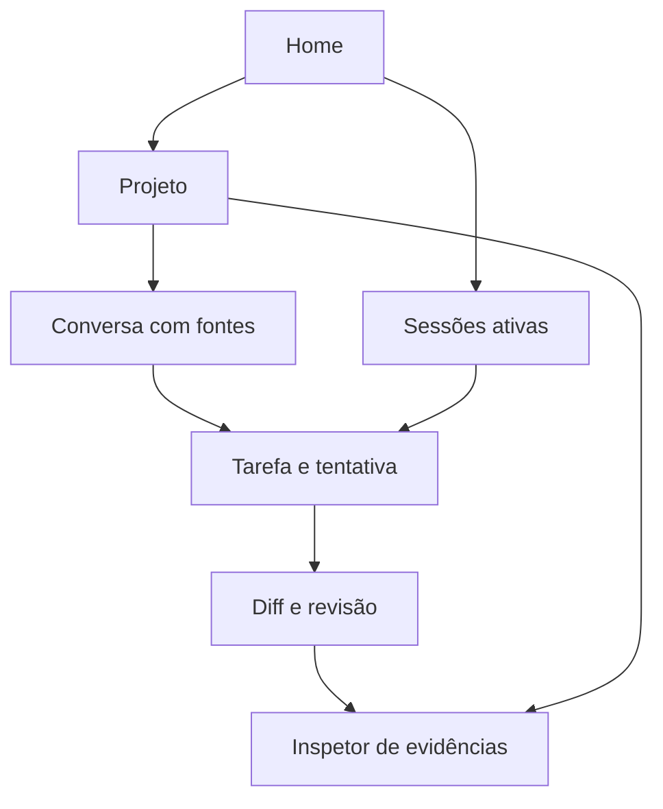

# Experiência desktop · a bancada de projetos

**Direção escolhida: Bancada de projetos.** A entrada é um portfólio vivo de trabalho. Uma tarefa em destaque responde “onde continuar”, a coluna de operações responde “quem está trabalhando” e o projeto conserva conversa, código e decisões. A conversa ocupa o centro quando a pessoa quer raciocinar. Quando chega uma alteração, o mesmo espaço vira revisão de código. O inspetor abre no contexto da fonte e devolve a pessoa ao ponto anterior.

[Abrir o protótipo navegável offline](visual/Workspace.html) · [Composição da Home](visual/Home.png) · [Composição da revisão](visual/Revisao.png) · [Tokens e especificação das nove superfícies](12-DESIGN-SYSTEM-AND-SCREEN-SPECS.md)

## Três direções de produto

| Direção | Como seria trabalhar nela | Escolha |
|---|---|---|
| **Bancada de projetos** · ChatGPT Desktop × Orca × inteligência de projetos | Sidebar de projetos, conversa central sob demanda, atividade e execuções discretas na Home. A tarefa destacada vira contexto do chat, do diff e do inspetor. | **Principal.** Atende tanto o dia em que Anthony faz uma pergunta curta sobre NexTM quanto o dia em que acompanha sessões em três produtos. |
| **Mesa de operações** | Fila temporal com colunas por worktree, log fixável e code review em duas áreas. O foco visual está em concorrência e intervenção. | Incorporar sua densidade na lista de sessões e na S5. A Home fortemente orientada a filas fica vazia para quem tem um único trabalho. |
| **Atlas de arquitetura** | Projeto abre em um mapa de módulos, decisões e dependências. Selecionar uma aresta abre o código e as tarefas associadas. | Reservar ao explorador de arquitetura. O mapa ajuda quando existe uma pergunta de impacto e precisa de alternativa textual equivalente. |

Do ChatGPT Desktop vem a continuidade da conversa com pouca navegação. Do Orca vêm a proximidade entre sessão, área Git e revisão. Do Entire vem o vínculo durável entre decisão e mudança. A marca de trabalho usa um lambda tipográfico, fundo grafite neutro, acento cobre e estados legíveis em texto. Tokens, navegação e composição são próprios. [ChatGPT Windows](https://help.openai.com/en/articles/9982051-using-the-chatgpt-windows-app) · [Orca](https://github.com/stablyai/orca) · [Entire](https://docs.entire.com/) · [Interface do VS Code](https://code.visualstudio.com/docs/editing/getting-started/userinterface)

## Primeiros 30 segundos

| Momento | Instalação nova | Retorno a um workspace usado |
|---|---|---|
| 0–5 s | A janela abre em português, com “Adicionar projeto” e opção de explorar um exemplo identificado. Fonte e destino de dados aparecem no momento necessário. | A Home abre com catálogo local e última tarefa. Branch e estado da revisão ficam junto do botão de continuar. |
| 5–15 s | Escolher uma pasta. O nome e o estado Git entram primeiro; a extração de manifestos pode prosseguir em segundo plano. Repo sem commit também entra. | Ver o outro projeto que tem agente ativo e uma decisão que aguarda revisão. Uma gravação local antiga aparece com horário da observação. |
| 15–30 s | Abrir o projeto e conferir a branch, arquivos modificados e tecnologias observadas. Ações de agente aparecem a partir da versão em que funcionam. | Abrir a tarefa pendente em um clique. O diff reaparece na seleção do projeto. A sessão do outro projeto segue ativa e acessível. |

A meta de 30 segundos descreve a leitura e as ações iniciais após abrir a janela. Download de dependências, autenticação e primeira indexação grande têm tempos próprios. Na S1, a Home inclui projetos e atividade local. A faixa de execuções ganha conteúdo com o supervisor da S3 e os sinais de evidência com a S4.

## Arquitetura da informação e percurso

A barra lateral contém **Área de trabalho**, **Sessões**, **Projetos** e **Preferências**. A área principal herda o projeto selecionado. As abas de projeto agrupam Visão geral, Conversa, Tarefa, Alterações, Fontes e Mapa conforme disponibilidade. Informações simples abrem em inspetor lateral; arquivos, logs longos e diffs podem ocupar a coluna principal. Há um caminho direto da sessão ao resultado e outro do resultado à sua origem.

Com teclado: Ctrl/Cmd+K abre paleta local e filtra projetos, tarefas e comandos. Enter abre o item filtrado; Esc fecha o overlay ou devolve foco ao invocador. Para o produto nativo, Ctrl/Cmd+1 abre Home e Ctrl/Cmd+2 abre sessões, editáveis se houver conflito. Nenhum atalho depende de ser global no sistema. Navegação entre projetos restaura a última aba, rascunho e posição próprios. A mudança de seleção jamais muda o destino de uma execução já iniciada.

## Composição da Home

Nos primeiros 900 px de altura, o topo concentra breadcrumb, busca e identidade do workspace. O título da Home precede uma única ação de adicionar projeto. A faixa horizontal de continuidade mostra projeto, tarefa, branch e estado. A lista de projetos traz nome, stack observada e branch. A coluna direita traz agente ativo e revisão que demanda decisão. Atividade recente usa linhas com verbo, entidade e instante. Sem agente, recolher a lista vazia ou indicar “Nenhum agente em execução”. Um projeto silencioso permanece encontrável na navegação.

Ordenação padrão: projetos fixados, último projeto aberto e atividade recente. Uma tarefa trabalhada fora do app não aparece como realizada sem evento Git ou registro de sessão que a sustente. Na versão com recomendações, só disputar a região de atenção quando houver ação concreta e fonte. Permitir dispensar por tarefa e motivo. Nunca usar atividade de Git como pontuação de desempenho do desenvolvedor.

## Estados e movimento

Abrir fonte desloca o inspetor em aproximadamente 140 ms e conserva a seleção do texto. Na troca de projeto, atualizar primeiro o contexto estável (nome e caminho); usar placeholders apenas em regiões realmente carregando. Se a leitura falhar, manter último resumo com “observado às …” e botão de tentar de novo. Perda de conexão mantém rascunho. Um agente executando tem nome, projeto e estado textual. Cancelamento em andamento vira “Parada solicitada” até confirmação. Novos eventos não deslocam a leitura de um log antigo; oferecer “Ver novos eventos”.

Respeitar movimento reduzido e não usar animações contínuas para sugerir atividade. Reorganização de largura e fixação de inspetor são persistidas por janela, com restaurar padrão. Em telas pequenas, voltar da fonte restaura o foco no arquivo que a abriu. Tema claro usa superfícies de papel e o mesmo acento cobre escurecido.

## Living Systems no desktop F1

A direção Living Systems usa Fraunces nos títulos de projeto e na Área de trabalho. IBM Plex Sans organiza títulos de seção, painéis e controles. Consolas distingue caminhos, branches e hashes. Noir, Astra e Quartz compartilham esses papéis, a escala de espaços e os estados semânticos.

- **Visão geral.** O cabeçalho de projeto é compacto. O caminho do checkout pode ser aberto por teclado. A decisão vigente, sua evidência e a leitura Git têm precedência na composição. A próxima ação usa tipografia operacional e mantém o rótulo de sugestão.
- **Contexto e Tarefas.** Busca e capturas ficam disponíveis na entrada de Contexto. A seleção de fontes e a verificação do provedor se expandem sob demanda. A lista e o detalhe da tarefa oferecem continuidade. Criar e editar abre um diálogo que devolve o foco ao controle de origem.
- **Alterações Git.** A listagem da árvore de trabalho tem data e filtros pela leitura recebida. A captura preservada mantém origem própria e oferece seleção de arquivo, comparação por camada e digests consultáveis.
- **Movimento.** O campo espectral mantém a fase na troca de projeto e usa uma ondulação curta na troca de seção. O render contínuo para fora da área visível, com pausa manual ou com a preferência de movimento reduzido.

[Evidência da segunda passagem visual](../docs/planning/STATUS.md#ev-ui-02)

## Living Systems 2.0 no desktop

A estrutura parte da direção Cognitive Workspace. A exploração usou o mesmo checkout fictício nas três direções. Editorial Instrument contribuiu com a hierarquia da decisão. Living Systems Reimagined contribuiu com o campo espectral. As referências `LAPLACE_LIVING_SYSTEMS_PREVIEW.html` e Screenshot_120–131 orientaram a segunda passagem, com navegação contextual arredondada, superfícies em camadas, tarefas e relações em painéis de consulta.

- **Navegação.** A lateral dá acesso à Área de trabalho, aos projetos, ao Laboratório e às Preferências. As abas Retomada, Contexto, Tarefas e Alterações Git pertencem ao checkout e aparecem sob seu cabeçalho. A paleta Ctrl+K reúne os destinos e as ações locais disponíveis. O destino atual tem indicação visual e semântica. Em janelas estreitas, a navegação usa o topo e o índice do Laboratório mantém os nove destinos acessíveis.
- **Workspace.** Projetos e leituras datadas ocupam a coluna principal. Retomada, sinais do catálogo e ferramentas em prévia ocupam a lateral de apoio. As contagens usam registros do catálogo e observações disponíveis na sessão. No Cockpit, atividade, decisão e Git conservam sua proveniência. Tarefas recentes e links para fontes dão continuidade à leitura.
- **Tipografia.** Fraunces para o nome do projeto e superfícies editoriais. Inter para leitura, controles e navegação. JetBrains Mono para arquivos, branches, hashes e código. As três fontes são locais e a interface usa escalas de 12 px para metadados, 14–15 px para controles e leitura e 19 px para títulos de painéis.
- **Temas e movimento.** Noir combina carvão e cobre, Astra usa azul frio e ciano, Quartz usa papel e tinta quente. Fundo, superfície, realce, foco e estados usam tokens semânticos. A profundidade vem do aro, da diferença de tom e de sombras curtas. O campo espectral ocupa as áreas de identidade. A seleção do grafo realça relações por tipo e respeita movimento reduzido.

| Componente | Variantes e estados |
| --- | --- |
| Shell, navegação, breadcrumbs e abas | Lateral no desktop e navegação no topo em largura reduzida. Projeto selecionado e destino atual com marca distinta. Ponteiro, teclado e foco visível. Breadcrumb com projeto e seção. |
| Paleta, busca e filtros | Paleta fechada, aberta, com seleção por setas e sem resultados. Busca FTS por captura selecionada ou recente. Índice em leitura, atualizado ou indisponível. Filtros, paginação e resultados preservados. |
| Toolbar e status | Ação primária, secundária, textual e desabilitada durante solicitação. Vínculo, disponibilidade, estado do serviço e proveniência têm rótulo textual. |
| Projeto e atividade | Checkout com leitura datada ou sem leitura na sessão. Lista preenchida, vazia ou indisponível. Atividade usa as leituras e revisões disponíveis. |
| Contexto, evidência e memória | Lista e inspetor. Captura, trecho, data, digest e cobertura. Lacuna explícita. Prova histórica, comparação e histórico de revisões. |
| Árvore Git e diff | Observação viva e captura preservada. Filtros de estado, camadas HEAD → Índice e Índice → Disco, diff unificado e versões lado a lado. |
| Tarefa e agente | Lista, filtro, detalhe e editor de tarefa. Tentativas Mock de desenvolvimento identificadas. Sessões do Laboratório com capacidade, tentativa, evidência e revisão simulada. |
| Grafo e relações | Tipos Decisão, Fonte e Tarefa. Filtros, nó ativo, lista navegável e inspetor com origem. Acento e rótulos distinguem tipos e seleção. |
| Diálogos e divulgações | Diálogo modal nativo para ações de entrada e edição. Resumo expansível para caminhos, procedência e manutenção. Títulos nativos ajudam a ler rótulos truncados. |
| Prévia e estados | Identificação persistente do Laboratório. Cenários carregando, preenchido, vazio, falha com reabertura e indisponível. Alterações da demonstração vivem na sessão da tela. |

### Integrações previstas

| Fase | Próxima integração |
| --- | --- |
| F1 | Pilotar os fluxos existentes com o autor em projetos autorizados e concluir os aceites de distribuição. |
| F2 | Ligar o manifesto e orçamento do Compilador ao ContextPackage, aos grants e à consulta com origem verificável. |
| F3 | Ligar Memória e Inbox ao catálogo versionado, revisão humana, retenção e expurgo. Começar KGraph pela projeção de relações confirmadas e timeline. |
| F4 | Ligar Pre-Flight, Planejador e Central às precondições, tentativas e revisão supervisionada. |
| F5 | Ligar Arena a worktrees com base comparável e Replay ao histórico bitemporal disponível. |

[Evidências de execução e limites](../docs/planning/STATUS.md#ev-ui-03) · [Roadmap F1–F5](../docs/planning/ROADMAP.md)

## Percurso para avaliar o protótipo

1. Abrir o HTML depois de extrair o ZIP. Na Home, verificar como uma tarefa em revisão no NexTM convive com uma sessão ativa no Iuris. Os dados são ilustrativos.
2. Abrir a tarefa, **Revisar alterações**, alternar **Índice** e **Trabalho**, abrir a fonte e registrar/reabrir revisão. O rótulo de revisão humana é independente do último teste observado.
3. No projeto, abrir **Conversa**, escrever uma pergunta e criar uma tarefa. Iniciar, interromper ou concluir a execução simulada. Usar a paleta para encontrar outro projeto, alternar o tema em Preferências e recarregar.
4. Experimentar Sessões e Mapa para observar a linguagem das superfícies posteriores. No protótipo, criar tarefa substitui o exemplo ativo daquele projeto. O produto persistirá múltiplas tarefas. O protótipo usa armazenamento do navegador quando disponível, sem integração real com arquivos ou modelos.

[Plano central](MASTER-PLAN.md) · [Critérios de engenharia](02-PRODUCT-VISION-PRD.md)
